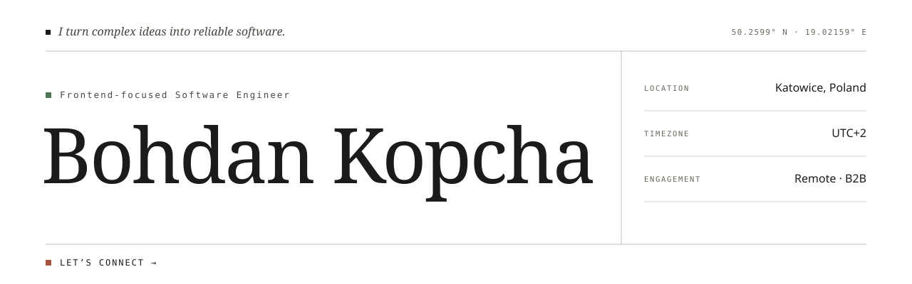
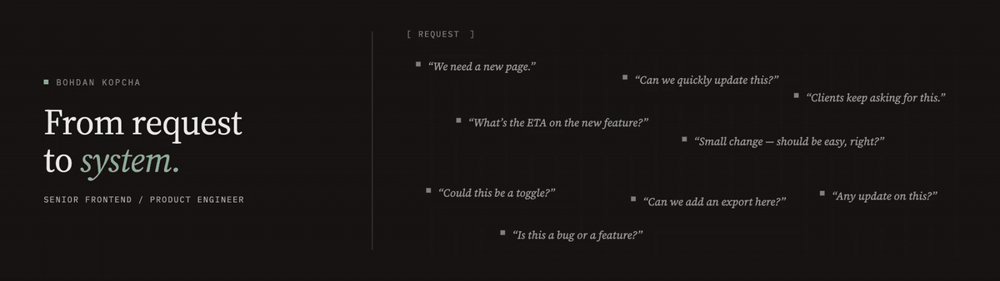

<a href="https://www.linkedin.com/in/bohdan-kopcha-478ab7314/">
  <picture>
    <source media="(prefers-color-scheme: dark)" srcset="./assets/bohdan-kopcha-hero-dark.svg">
    
  </picture>
</a>

 

## About

I build AI products end to end, from the first spec to production.

Forward Deployed AI Engineer with **7+ years of experience building web products**. I work across the full stack: shaping the feature with the team, designing the UI and the API, building the backend and frontend, and carrying it through delivery. Recently focused on agentic AI features, MCP integrations, and AI-assisted workflows for data-heavy platforms in fintech, investment, and real-time operational software.

<table>
  <tr>
    <td>
      <h3>Have a product challenge worth solving?</h3>
      
If you are shipping an AI feature into a real workflow, need an engineer who can own it from spec to production, or want to turn a messy process into a reliable product, let’s talk. I am open to remote B2B collaboration and meaningful engineering conversations.

      
<strong><a href="https://bohdankopcha.dev/">bohdankopcha.dev</a> &nbsp;·&nbsp; <a href="https://www.linkedin.com/in/bohdan-kopcha-478ab7314/">Connect on LinkedIn</a> &nbsp;·&nbsp; <a href="mailto:kopchabogdan@gmail.com">kopchabogdan@gmail.com</a> &nbsp;·&nbsp; <a href="tel:+48508136641">Call or message: +48 508 136 641</a></strong>

    </td>
  </tr>
</table>

 

---

## From request to system

### Clarity is a product feature.

A good interface does more than look polished. It helps people understand what matters, make confident decisions, and move through complex work without unnecessary friction.

<!--  -->

 

---

## Building with AI

  
  &nbsp;&nbsp;
  
  &nbsp;&nbsp;
  
  &nbsp;&nbsp;
  
  &nbsp;&nbsp;
  
  &nbsp;&nbsp;
  
  &nbsp;&nbsp;
  
  &nbsp;&nbsp;
  
  &nbsp;&nbsp;
  

## Building interfaces with

  
  &nbsp;&nbsp;
  
  &nbsp;&nbsp;
  
  &nbsp;&nbsp;
  
  &nbsp;&nbsp;
  
  &nbsp;&nbsp;
  
  &nbsp;&nbsp;
  
  &nbsp;&nbsp;
  
  &nbsp;&nbsp;
  
  &nbsp;&nbsp;
  
  &nbsp;&nbsp;
  
  &nbsp;&nbsp;
  

## Building APIs with

  
  &nbsp;&nbsp;
  
  &nbsp;&nbsp;
  
  &nbsp;&nbsp;
  
  &nbsp;&nbsp;
  
  &nbsp;&nbsp;
  
  &nbsp;&nbsp;
  
  &nbsp;&nbsp;
  
  &nbsp;&nbsp;
  
  &nbsp;&nbsp;
  
  &nbsp;&nbsp;
  
  &nbsp;&nbsp;
  
  &nbsp;&nbsp;
  

## Storing data with

  
  &nbsp;&nbsp;
  
  &nbsp;&nbsp;
  
  &nbsp;&nbsp;
  
  &nbsp;&nbsp;
  
  &nbsp;&nbsp;
  

## Debugging with

  
  &nbsp;&nbsp;
  
  &nbsp;&nbsp;
  
  &nbsp;&nbsp;
  
  &nbsp;&nbsp;
  
  &nbsp;&nbsp;
  

## Deploying with

  <picture>
    <source media="(prefers-color-scheme: dark)" srcset="https://cdn.jsdelivr.net/gh/devicons/devicon/icons/amazonwebservices/amazonwebservices-plain-wordmark.svg">
    
  </picture>
  &nbsp;&nbsp;
  
  &nbsp;&nbsp;
  
  &nbsp;&nbsp;
  
  &nbsp;&nbsp;
  
  &nbsp;&nbsp;
  
  &nbsp;&nbsp;
  
  &nbsp;&nbsp;
  
  &nbsp;&nbsp;
  

 

---

## How I approach product work

🧭 **Start with the workflow, not the model.** The best AI features begin with the people, decisions, and data behind a task. I sit close to users and find where AI actually removes work.

🚢 **Own it from spec to production.** I shape the spec, design the API and the UI, build both sides, and stay on the feature after launch.

🛡️ **Make agents trustworthy.** Tool calling, human-in-the-loop review, guardrails, observability, and evals are part of the build, so teams can rely on the output.

⚡ **Ship fast, keep it maintainable.** I use AI-assisted delivery to shorten feedback loops (about 70% faster client-feedback turnaround at Hedgineer) while keeping architecture and review in human hands.

🔎 **Leave the system clearer.** Better codebase, better team workflow, better product experience than I found.

 

---

## Certifications worth mentioning

### Claude Certified Architect — Foundations

Certified in designing effective Claude-powered solutions and agentic workflows.
